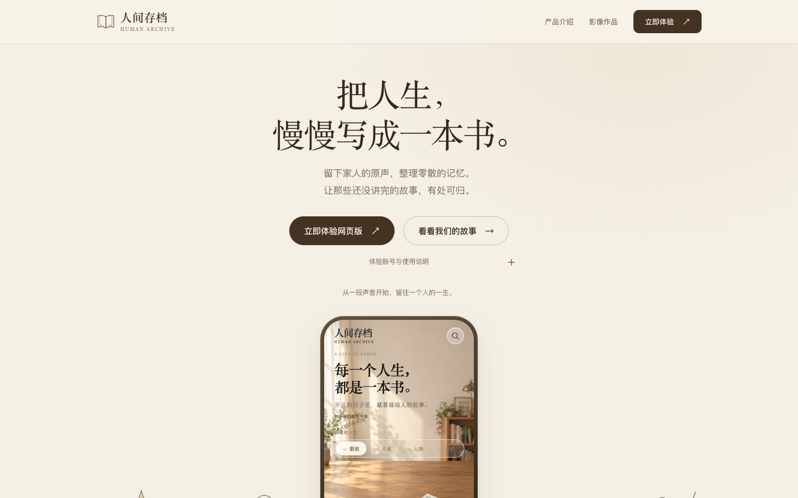
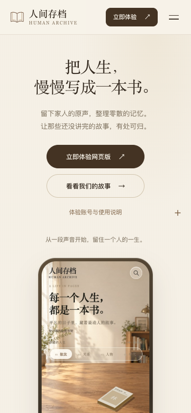
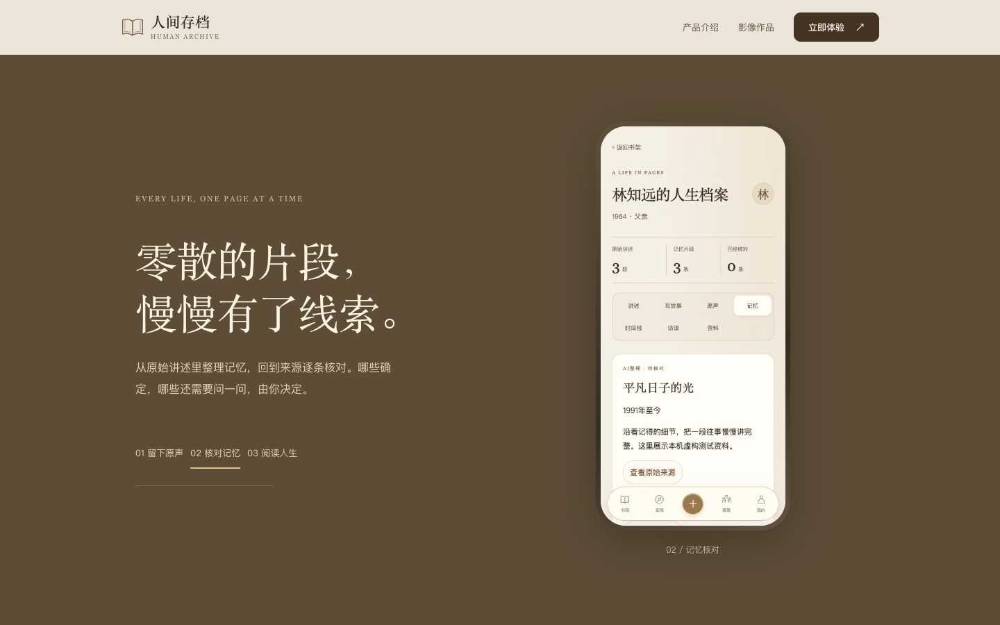

# 营销官网重构审查
基线 `57c196b8f8f40928e8d8e4c680f92b8be4537560`。两轮提交：先中性结构，再用户确认的暖纸品牌。原生 HTML/CSS/JS；无需更换框架。

参照 Gaia 的居中首屏、滚动故事与交替手机展示，原创书信线稿、暖纸颜色和出版物字体替换品牌；没有复制其婴儿素材、文案或源码。手机图为本次 App UI 的实际本机截图，虚构数据，公开体验版本尚未更新。详见 assets/screens/provenance.json。Figtree 使用随附 OFL 许可。

主 CTA 进入现有网页版；人间存档为主要影像，昆仑谣为关联作品。保留四个用户提供的视频链接、共用体验说明与现有 Android v1.0.3 下载。旧公开产品资源和部署目录未替换。

| 手机首屏 | 滚动故事 |
|---|---|
|  |  |

`npm ci && npm test`，需要本机 Chrome（或设置 PLAYWRIGHT_CHANNEL）。测试内建 loopback 静态服务器，验证子目录部署、五视口、三滚动状态、菜单/FAQ/弹窗键盘、链接、资源、减少动画和禁用 JS 阅读。结果 web-results.json：PASS，无溢出/失效图片/未处理异常。原站像素比较仅用于结构研究，不作为换品牌后的全局评分。

预览：`python3 -m http.server 18886 --bind 127.0.0.1`。无需构建。回滚：对本 PR 两个提交按新到旧 `git revert`；未修改部署配置、产品 API 或公开安装包。Safari/Android WebView 运行未验证；不得据此宣称真机验收完成。
