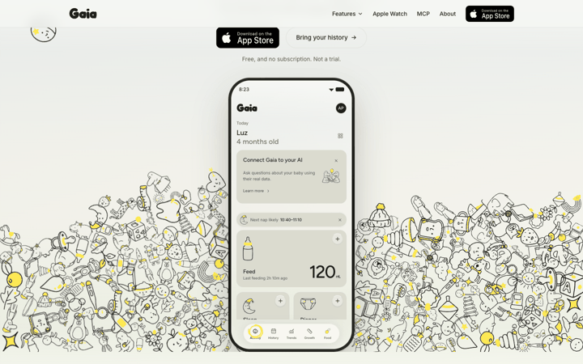
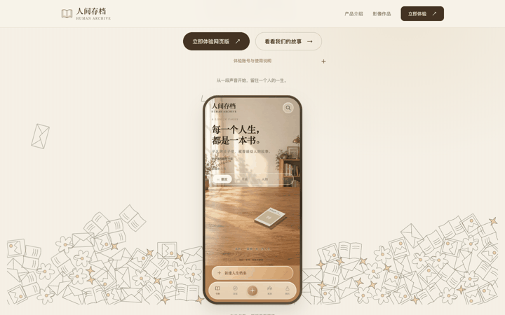

# 首屏鼠标物理装饰验收

范围：在 `ecf016be208ef7f5b13966578cd56da8bc9d310c` 上独立增加物理装饰。没有修改布局、品牌配色、App、后端、现有滚动叙事或产品入口。未合并、未部署。

## 原站机制与重建

已导出脚本 `motion.7520731b6b94.js`，SHA-256 `7520731b6b94013a248923d4fa46d44be715804aadcd6c9ae07ee9f8c8ee0d3e`。以下参数直接取自脚本，鼠标效果另以真实 Playwright 事件验证；没有直接给测试物体注入力。

| 环节 | 源码定位 / 确认参数 | 本地实现 |
|---|---|---|
| 世界 | `k.create({enableSleeping:!0})`；重力 1.1，位置/速度迭代 10/8 | Matter.js 0.20.0，相同参数 |
| 刚体/边界 | 半径系数 .86；restitution .5，friction .06，static .12，air .009，density .0009；墙厚 240；手机静态矩形和斜顶 | 同参数；墙体和手机障碍适配现有展示区 |
| 出场 | 每帧 12 个；黄金角 2.399963229728653；速度 6.5+index%3，向上 -5.5；延迟 .68s，透明度 260ms | 相同物理出场；保留原页面进入动画，未引入 GSAP |
| 鼠标施力 | `pointermove` → `beforeUpdate` → `f.applyForce`；半径 170，速度阈值 15，上限 90；系数 .0027，距离平方衰减，位移乘 .82 衰减 | 相同径向力算法；慢移低于阈值不额外施力 |
| 拖拽 | `W.create`，stiffness .09 / damping .12 | 同约束；使用被动全局 pointer 事件提供坐标，跳过链接、按钮、手机等交互区域 |
| 碰撞形变 | `collisionStart`；相对速度 /16，上限 1，再乘 .3；`afterUpdate` 写 translate/rotate/scale(1+s,1-s)，s 乘 .86，低于 .002 归零 | 同参数与 DOM/SVG 同步；不是截图拼接 |
| 点击/松手 | 小于 8px 的点击作半径 170 径向 kick；真正拖拽松手解除约束 | 相同 kick 与释放逻辑 |
| 暂停/清理 | 原站可见性/离屏暂停、resize 重建；完整 destroy 接口未找到，UNKNOWN | 显式停止 Runner，清事件/世界/定时器/rAF/观察器；pagehide 清理，返回重建 |

已有 `assets/memory-doodles.svg` 是组合素材：复用 book/photo/letter/star/flower 五个定义，拆成独立 SVG 刚体；原文件未修改，心形和装饰连线保留在静态降级图中。引擎是 npm `matter-js@0.20.0` 的未改动发行文件，附 MIT 许可；Playwright 1.64.1 仅测试使用，没有引入其他运行依赖。

运动区仅在现有 `.hero-art`，装饰层 inert、aria-hidden、pointer-events:none；手机和 CTA 保持可点击。用户可用 `?decorations=off` 或 `ArchiveDecorations.setEnabled(false)` 关闭；`ArchiveDecorations.destroy()` 完整销毁。小于等于 760px、粗指针或减少动画偏好使用原静态图；素材或引擎不可用也保留静态图。

## 验证与限制

最终运行：Chrome / Playwright 1.64.1，分别采集真实鼠标事件。原站 PASS 只表示施力/碰撞/形变断言通过，**不包括原站拖拽**。

| 项目 | 原站 | 本地 |
|---|---|---|
| 刚体数 | 238 | 97 |
| 慢速施力调用 | 0 | 0 |
| 快速扫过施力调用 | 594 | 445 |
| 快速扫过碰撞对数 | 99 | 45 |
| 最大 squash | 0.3 | 0.3 |
| 拖拽物体位移 | 0px（覆盖层拦截） | 131.0px |
| 松手约束解除 | True | True |
| Engine.update p95 | 2.4ms | 0.6ms |
| 松手后 2 秒 rAF 间隔 p95 | 16.7ms | 16.8ms |

- 本地 PASS：真实拖拽 >30px、释放、碰撞形变；开关前后标题/按钮/手机/故事区几何不变；CTA 命中与锚点点击；1280/768/390/360/1440 缩放无溢出；粗指针、初始/动态减少动画、URL 关闭、素材请求失败均回退静态图。
- 清理 PASS：离屏后更新不再增长；模拟 pagehide/pageshow、完整 destroy；真实导航离开时世界刚体与装饰 DOM 均为 0，历史返回后重建。
- 既有 `npm test` PASS：五视口、三段滚动、手机菜单/Escape/焦点、FAQ 键盘、下载弹窗、视频及产品链接、APK 存在、子目录、禁用 JS；未捕获异常为 0。没有访问 App 业务。
- [精简数值与多帧清单](results.json)。Engine 包装只观察，不修改参数；有观察开销与截图停顿，刚体数不同，不能视为整站性能或绝对 60fps 保证。rAF 是松手后采样，非整个交互过程帧率。
- 初次拖拽断言采样过早，改为实际跟随位移；真实导航异步回传丢失，改为 pagehide 内同步记录后通过。失败尝试截图保留在本机 diagnostics，不作为通过证据。

下面 GIF 来自连续多帧截图，统一 140ms 播放，**不是实时录像或严格时序比较**。真实物理数据见 results.json。

| 原站 | 本地 |
|---|---|
|  |  |

复跑：`npm ci && npm run test:physics`；需要已安装 Chrome。原站对照：`PHYSICS_REFERENCE=1 npm run test:physics`。测试自建临时 loopback 服务并在结束关闭；不提交账号操作、真实订单或产品 API 请求。`npm test` 验证原有官网交互。

原始完整证据保存在本机 `output/playwright/gaia-physics-20261016/`：reference/local 下的 results.json 含真实物体位置、约束状态、力调用、碰撞、性能和连续多帧；source motion JS 在既有 `output/playwright/gaia-20261016/rea/exported-scripts/`。本目录提供精简结果和关键多帧。原始脚本没有作为发布资产。

限制：原站实测首屏装饰点命中 `.hero-centre` 覆盖层，MouseConstraint 的 button 始终为 -1，未抓到刚体；因此“原站拖拽手感一致”标为 UNKNOWN，不因源码存在约束而声称验证成功。本地真实拖拽必须测到物体跟随超过 30px，并验证松手解除。原站完整页面销毁和其余未采集页面的交互也为 UNKNOWN。

现有布局不变，所以场地尺寸、刚体数及素材尺度与原站不同；相同动力学参数不等于像素或整体手感完全复刻。原站手机 GSAP yPercent 26→0 / 1.05s 的独立进入动画没有移植，避免本次修改其他交互。连续帧已目视核对散开、堆叠、拖拽及回落，但没有完成用户主观手感验收。Chrome 本机证据不能代表 Safari/Android 真机性能；后台标签页 visibilitychange 有代码处理，本轮没有真实后台标签的运行证据。

回滚仅需 revert 本次独立物理提交；原有两轮官网提交保留。
