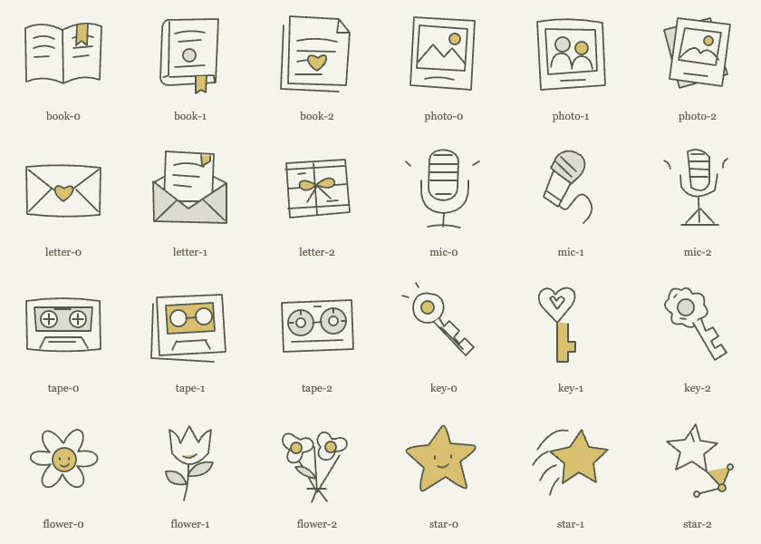
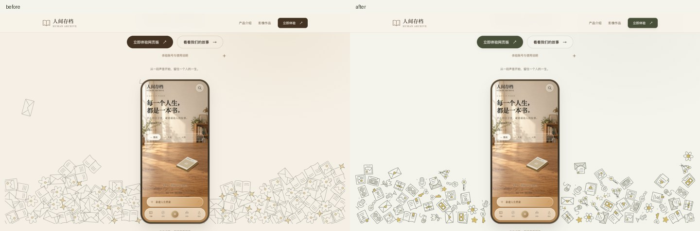
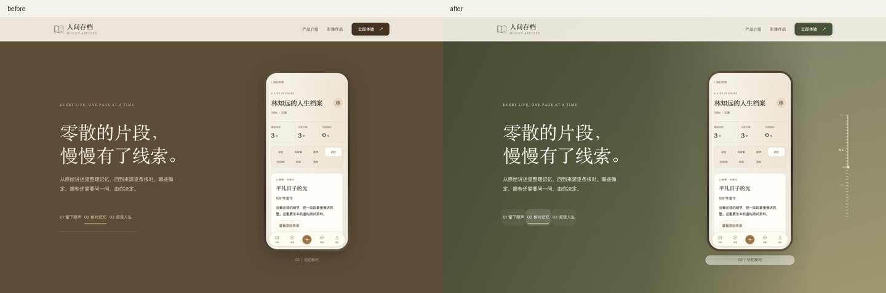
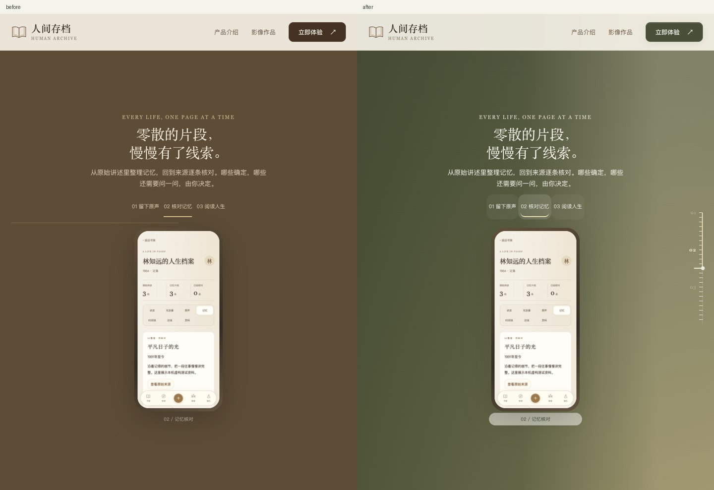
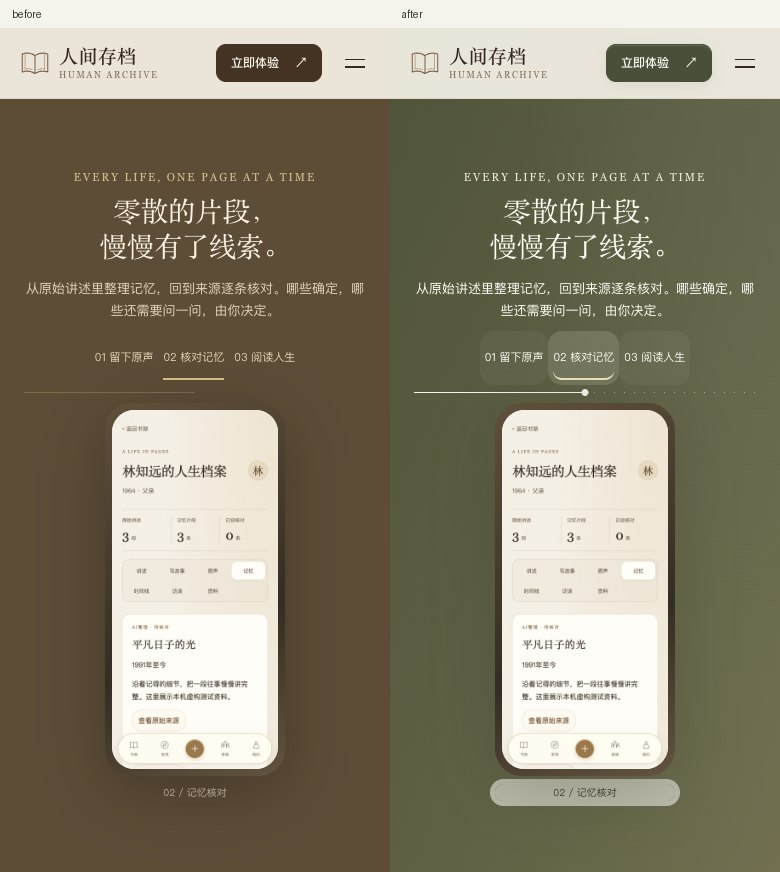
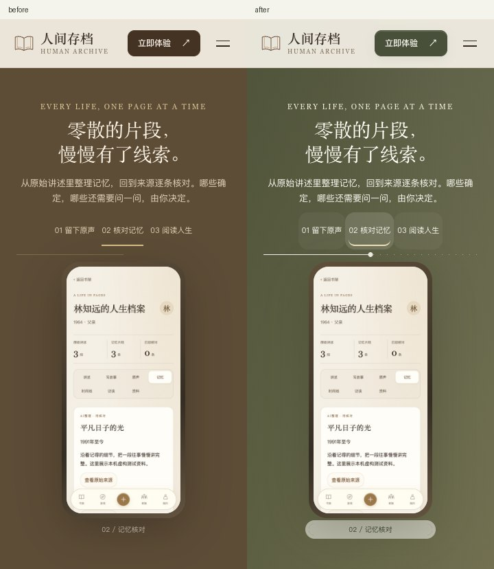
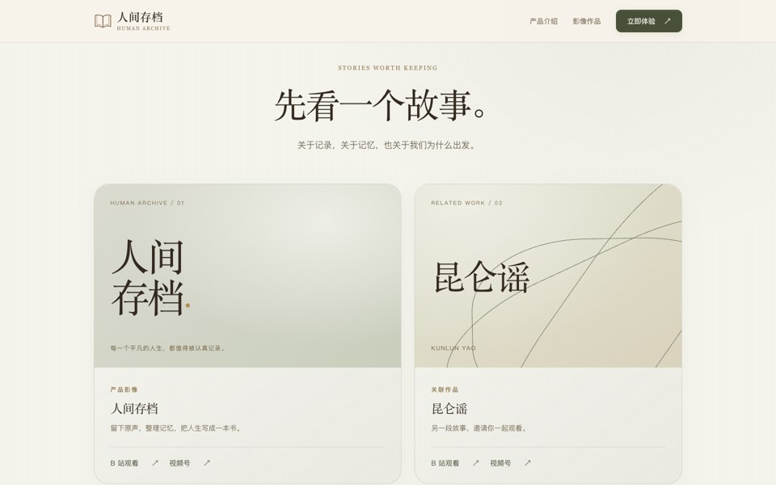
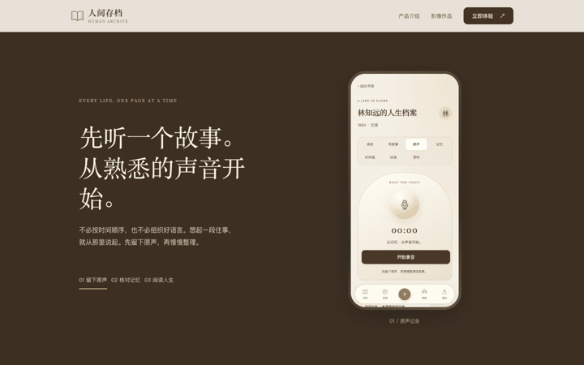
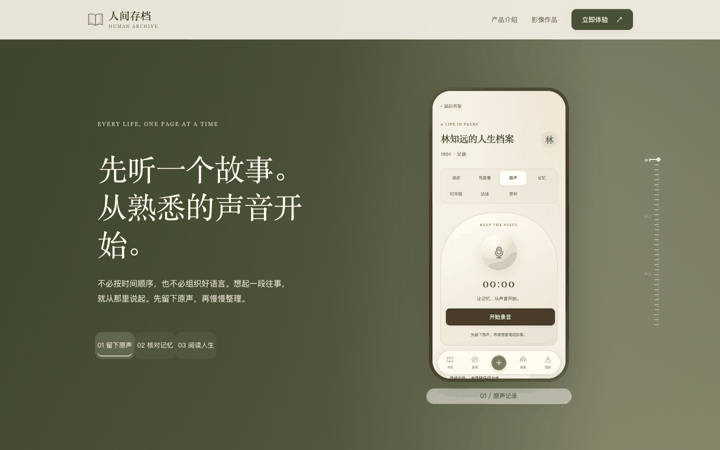
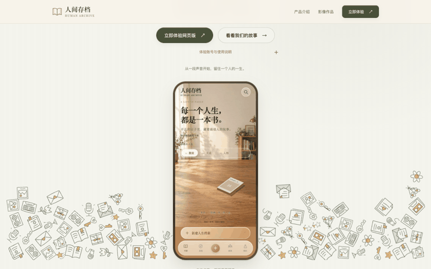

# 官网视觉增量验收 · 2026-10-17

基于 `1f45c96`，仅升级官网现有视觉；页面顺序、比例、文案、手机图、视频/下载/产品链接不变，没有修改 App、后端、`story.js`、`site.js` 或 Matter.js 物理算法。分两次提交，便于分别回退。

1. `90b938d`：24 个原创手绘图案（8 类 × 3 种）、素材尺寸映射、纸白底色、鼠尾草绿至柔沙金渐变。图案为书页、照片、家书、话筒、磁带、钥匙、花朵、星星；少数带表情，带不规则曲线和少量黄色填充。没有使用 Emoji 或第三方图案资产。
2. 本报告所在提交：竖直滚动刻度、移动端横向简化、局部半透明按钮/标签/影像卡片与测试证据。背景暗部帮助文案可读，主 CTA 对比度断言 ≥4.5。毛玻璃仅用于小组件，主体卡片用低对比渐变和细边框；不依赖模糊才能阅读。

## 前后截图与动态

| 桌面 1440：左改前 / 右改后 | 平板 768：左改前 / 右改后 |
|---|---|
|  |  |

| 手机 390：左改前 / 右改后 | 小屏 360：左改前 / 右改后 |
|---|---|
|  |  |

| 滚动叙事改前 | 滚动叙事改后 |
|---|---|
|  |  |

| 物理装饰改前 | 物理装饰改后 |
|---|---|
|  |  |

GIF 是真实连续多帧的预览，按固定间隔播放，不是真实时长录像；滚动按相同 0–100% 位置采样，物理因布局保留、素材大小和测试所选目标不同，不能用 GIF 判断逐像素一致。

## 验证结论

- `tests/visual-system.mjs`：1440×900、768×1024、390×844、360×800 全部 PASS。每个视口 11 个滚动位置，刻度位置最大归一化误差 <0.00005；阶段高亮正确，均覆盖 0/1/2。移动端无竖轨遮挡，减少动画时刻度隐藏、三段文案可读，无 JavaScript 时也不显示悬空刻度。
- 所有四视口的文案、链接、静态图片路径、各章节高度及首屏手机宽度均与 `1f45c96` 基线完全一致。没有引入另一套滚动控制；新增刻度纯 CSS 读取现有 `--story-progress` 与 `data-scene`。
- 空白核验：改前、改后四视口各 11 个实际滚动位置，当前文案和手机都在可视区，无空白采样点。未复现长时间纯色空白；整页截图的大片区域符合 sticky 预留的滚动距离。本轮未为了整页截图压缩故事高度；该结论仅覆盖上述视口和采样，不等于验证所有可能窗口高度。
- `npm test`：现有五视口、菜单/Escape/焦点、FAQ 键盘、三阶段、下载弹窗、产品/视频链接、APK 存在、子目录、减少动画与无 JS 阅读全部 PASS；无溢出、损坏图片、未捕获异常。
- `npm run test:physics`：PASS。新图案实际使用 93 个刚体（原 97，来自现有面积/素材尺寸密度公式），没有改变施力/阻尼/碰撞参数。真实拖拽跟随约 106.4px，松手解除，最大 squash 0.3；开关、五宽度、粗指针、减少动画、素材失败、离屏暂停、页面离开清空与历史返回重建均通过。Engine.update p95 约 0.6ms，为带观察器的本机 Chrome 数据，不是全站或真机性能保证。

[精简测试结果](results.json)；[改前基线](baseline.json)。完整截图/物体轨迹保留在本机 `output/playwright/gaia-visual-20261017/{before,after,physics,site-regression}/`，未覆盖上一轮原站采集材料。

复跑：`npm ci && npm test && npm run test:physics && npm run test:visual`，需要本机 Chrome。视觉测试默认与本目录 baseline.json 比较；设置 `VISUAL_PHASE=before` 可生成新的本地基线，审阅本轮时应保留已冻结的基线。测试用临时本机服务，结束自动关闭。

本轮仅读取已有原站 CSS/布局证据：`site.d0458e1a9ee3.css` 的纸灰渐变、低透明背景、8–14px 局部模糊与低对比边框提供材质依据。四个指定色是本次用户确认的近似视觉方案，不冒充原站 CSS 变量；新素材与参数无额外运行依赖。没有重新部署参考站，也没有重新逆向整站。

Safari/真机表现、原站被覆盖层拦截的拖拽手感、用户最终审美验收仍为 UNKNOWN。保持现有 PR 为 Draft，不合并、不部署。回滚第二提交撤销刻度/材质，回滚 `90b938d` 撤销图案/基础渐变；按新到旧回滚可恢复 `1f45c96`。
